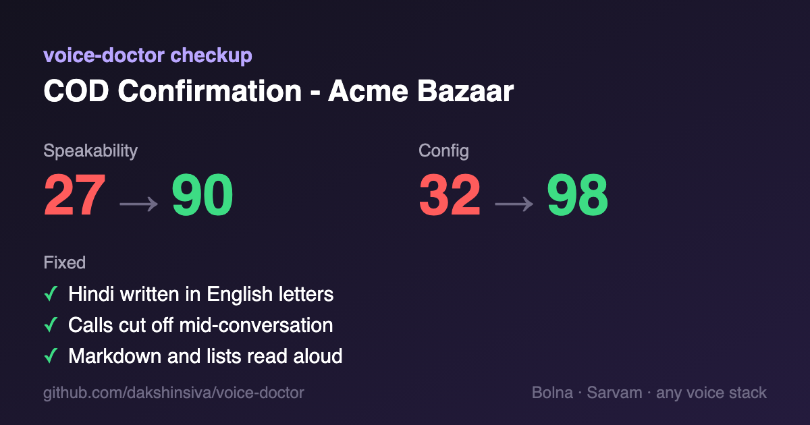

<div align="center">

# 🩺 voice-doctor

**Your voice agent sounds robotic. voice-doctor finds out why and fixes it.**

A Claude Code skill that listens to your phone agent the way a caller does (prompt, config and real calls), finds what makes it sound robotic, slow or rude, then rewrites the prompt, fixes the config and tells you exactly what to test.
Built for **Bolna + Sarvam**, Indian languages first. Config checks for **Vapi** and **Retell** too.

[](https://github.com/dakshinsiva/voice-doctor/actions/workflows/tests.yml)
[](LICENSE)


</div>

```bash
claude plugin marketplace add dakshinsiva/voice-doctor && claude plugin install voice-doctor@voice-doctor
```

Then, in Claude Code: *"my Bolna agent sounds robotic, here's the export: agent.json"*

<p align="center"></p>

## What robotic sounds like

What callers heard from a real-shaped COD confirmation agent:

> Namaste Rahul ji! Main Neha bol rahi hoon Acme Bazaar se. Aapne humare store se ek Cash on Delivery order place kiya hai, order number AB-20931, jiski amount ₹1,499 hai. Kya aap abhi order confirm karna chahenge? Aur kya delivery address same rahega?

43 words, about 17 seconds before the caller can speak. Two questions at once. Romanised Hindi going to a Sarvam voice. The order number and amount told to whoever picks up, including voicemail.

After voice-doctor:

> नमस्ते, मैं नेहा, Acme Bazaar की AI assistant। आपके order के बारे में call किया है। क्या मेरी बात {{customer_name}} जी से हो रही है?

22 words. One question. Devanagari with English words left in English, the way Sarvam pronounces best. Says it's an AI. Checks who answered before sharing anything.

## Why agents sound robotic, and what it catches

Found in testing, on synthetic agents, public Bolna agents from GitHub and a live Bolna account:

- ✂️ **Calls cut off mid-sentence.** `call_terminate` left at the 90 s default while the prompt says the call takes 2–3 minutes. 2 of 5 answered calls died at exactly 90 s.
- 👂 **The agent talks over people.** Endpointing at 100 ms, so it cut in while customers were reading out their pincode, three times in one call.
- 📞 **"Thank you" hangs up the call.** With `hangup_after_LLMCall` on and no `call_cancellation_prompt`, Bolna's default check ends the call when a caller says "theek hai, thank you" mid-conversation.
- 🗣️ **Robotic Hindi.** Romanised Hindi sent to a Sarvam voice, textbook "क्या आप … करना चाहेंगे?", "आपका दिन शुभ हो", the wrong verb gender for the persona, written Kannada instead of spoken Kannada.
- 🎭 **A voice that doesn't exist.** `anushka` is a v2/v3 name; it isn't a `bulbul:v4-flash` voice. ElevenLabs Flash on a Kannada agent. Cartesia with no language on a Tamil agent.
- 🔗 **Things nobody can use by ear.** Order IDs, `#` signs, links, emails, `**bold**` and "18/10" read aloud.
- 🧩 **Template leftovers.** A literal `***REMOVED***` in the persona line and a `your-domain.com` webhook in an open-source agent people copy.
- 🪤 **Platform traps.** Retell keeps a silent call open for 10 minutes by default and has no voicemail detection on agents created through the API. Vapi's voicemail detection is off by default, and fields like `silenceTimeoutSeconds` aren't in its current schema. Neither platform covers every Indian language: Retell has no Telugu, Malayalam, Bengali, Gujarati or Punjabi.
- 🐢 **Slow turns, measured.** LLM first token p50 1,480 ms / p95 1,910 ms from `reasoning_effort: medium`, plus 1,000 ms of configured waits, across every call in `latency_data`.

## What you get

| | |
|---|---|
| `report.md` | Ranked by what the caller experiences, with evidence from your calls |
| `system_prompt.md` | Rewritten to be spoken: short turns, situations (busy, wrong person, voicemail, "are you a robot?"), safety limits |
| `welcome.txt` | Under 25 words, discloses AI, checks identity first |
| `config-changes.json` | Only the fields to change, in Bolna's structure |
| Test-call script | 5–8 things to say on a real call to prove the fixes |

Plus a before/after **speakability** and **config** score you can track.

## Why not just ask Claude?

You can, and on the strongest model with web search it gets a lot right. The difference is what it gets *wrong*. Without the skill, Claude told a user Deepgram Nova-3 is English-only on Bolna (it isn't), missed that `anushka` isn't a v4 Flash voice, left the AI disclosure out of the welcome, and quoted a customer's full address in its report. voice-doctor carries verified 2026 facts (Bolna defaults and field names, which Sarvam / Deepgram / ElevenLabs / Cartesia models support which Indian languages, current deprecations) plus scripts that check dozens of calls at once.

## Tested against plain Claude

4 tasks (prompt rewrite, config audit, call review, and a real open-source Bolna agent), 54 pass/fail checks, graded by an independent Claude grader that verified every claim against the inputs and vendor docs:

| | With voice-doctor | Plain Claude |
|---|---|---|
| **Sonnet, no web search** (the everyday setup) | **53/54 (98%)** | 37/54 (69%) |
| **Opus 5.5 with web search** (the hardest baseline) | **53/54 (98%)** | 43/54 (80%) |

The gap is biggest where most people work: everyday models without web search. **Sonnet with voice-doctor outscored Opus with web search without it, and finished faster.**

What plain Claude got wrong that the skill didn't:
- Recommended models Sarvam has deprecated (`saarika:v2.5`, `bulbul:v2`) and said Bolna's `keywords` only work on Deepgram.
- Kept romanised Hindi for a Sarvam voice ("Sarvam handles it"). Sarvam's docs say it degrades pronunciation.
- Advised a temperature that GPT-5 models on Bolna reject, and said Deepgram Nova-3 is English-only on Bolna.
- Shipped "fixed" configs that still used the invalid `anushka` voice, left the AI disclosure out of the welcome, and quoted a customer's full address in its report.

The trade-off: with the skill, a task takes one or two minutes longer, because it runs its checks and writes the full set of files.

Triggering: installed, Claude Code (Sonnet 4.6) loaded the skill on 10 of 10 voice-agent requests and on none of 10 near-misses (TTS scripting, webhook code, transcription, buying numbers).

One run per task per setup, so read these as strong signals, not a benchmark. Prompts and checks are in [`evals/`](evals).

## How it works

Three checks, used depending on what you give it:

| Check | Input | What it looks at |
|---|---|---|
| Prompt | system prompt, welcome, per-call variables | markdown, links, numbers in the form your TTS wants, script and register for Indian languages, turn length, missing situations |
| Config | Bolna agent JSON, Vapi assistant, or Retell agent + LLM | endpointing, interruptions, silence and hang-up timers, call length cap, voice and model language support, reasoning effort, TTS buffer, voicemail, calling hours, outcome capture |
| Calls | Bolna executions | latency p50/p95 per component, interruptions, monologues, "hello? are you there?", loops, unspeakable output, calls hitting the cap, worst calls to listen to |

The scripts are plain Python 3 with no dependencies. Claude reads their output, reads your prompt and worst calls itself, and writes the fixes.

**It only reads.** It never changes your agent or places calls. When you want fixes applied, it shows the exact changes and applies them only after you say yes, through your dashboard, Bolna's MCP server or the CLI.

## Share your checkup

After a checkup, voice-doctor can make a scorecard like the one above (1200×630, the size Slack, X and LinkedIn preview) and a badge for your README:

```bash
python3 skills/voice-doctor/scripts/scorecard.py agent.json --after agent.fixed.json --badge
```


## Use it in CI

Keep your agent configs and prompts in git? Fail the PR when a change makes the agent sound worse. Findings show up inline on the diff.

```yaml
# .github/workflows/voice-doctor.yml
on: pull_request
jobs:
  voice-doctor:
    runs-on: ubuntu-latest
    steps:
      - uses: actions/checkout@v4
      - uses: dakshinsiva/voice-doctor@v0.3.0
        with:
          agents: agents/**/*.json   # Bolna agent exports: config + prompt
          prompts: prompts/*.md      # standalone prompts (optional)
          tts: sarvam-v4             # voice engine for standalone prompts
          min-config-score: 80       # 0 = report only
          min-speakability: 85
```

## Getting your data from Bolna

Whichever you have:
- **Export** the agent JSON from the dashboard and point Claude at it.
- **Bolna's MCP server or Claude connector**: Claude reads agents and executions directly.
- **Bolna CLI**: `bolna agents view <id> --json`
- **The bundled read-only script**: `export BOLNA_API_KEY=...` in your own terminal, then Claude runs `scripts/bolna_api.py`. The key is never printed.

Many agents? `bolna_api.py export agents/` then `audit_config.py agents/` ranks every agent in the account, worst first.

## Works alongside Bolna's skills

[Bolna's official skills](https://github.com/bolna-ai/skills) create agents, place calls and debug a single execution (`debug-bolna-calls`). voice-doctor is the checkup layer on top: it scores the whole agent, checks how prompts sound, and turns many calls into one ranked fix list. Use both.

## Run the checks yourself

```bash
python3 skills/voice-doctor/scripts/audit_config.py examples/cod-confirmation/agent.json
```

```bash
python3 skills/voice-doctor/scripts/lint_prompt.py --agent-json examples/cod-confirmation/agent.json --vars customer_name,order_id
```

```bash
python3 skills/voice-doctor/scripts/call_stats.py examples/cod-confirmation/executions.json --agent-json examples/cod-confirmation/agent.json
```

Other ways to install: copy `skills/voice-doctor` into `~/.claude/skills/`.

## How it knows

Rules come from Bolna's docs and open-source engine, Vapi's and Retell's API specs (checked 26 October 2026), the Sarvam, Cartesia, Deepgram and ElevenLabs docs (checked 17 October 2026), and research on code-mixed Hindi and spoken Kannada. Where vendor docs contradict each other (they do, on number handling), the skill says so and makes it part of the test call instead of guessing. Sources are in [`references/`](skills/voice-doctor/references). The examples in [`examples/`](examples) are synthetic: Bolna's field names, made-up values. Scores are heuristics for tracking progress, not a quality guarantee.

## Contributing

Most wanted:
- Real cases where a rule is wrong. Open an issue with the redacted prompt or transcript.
- Tamil, Telugu, Bengali and Marathi phrasing rules from native speakers.
- Config checks for LiveKit and Pipecat (Vapi and Retell are in).

Run `python3 -m unittest discover tests` before a PR, and add a test for any new check.

If voice-doctor saves you a bad launch, a ⭐ helps other builders find it.

## License

MIT
